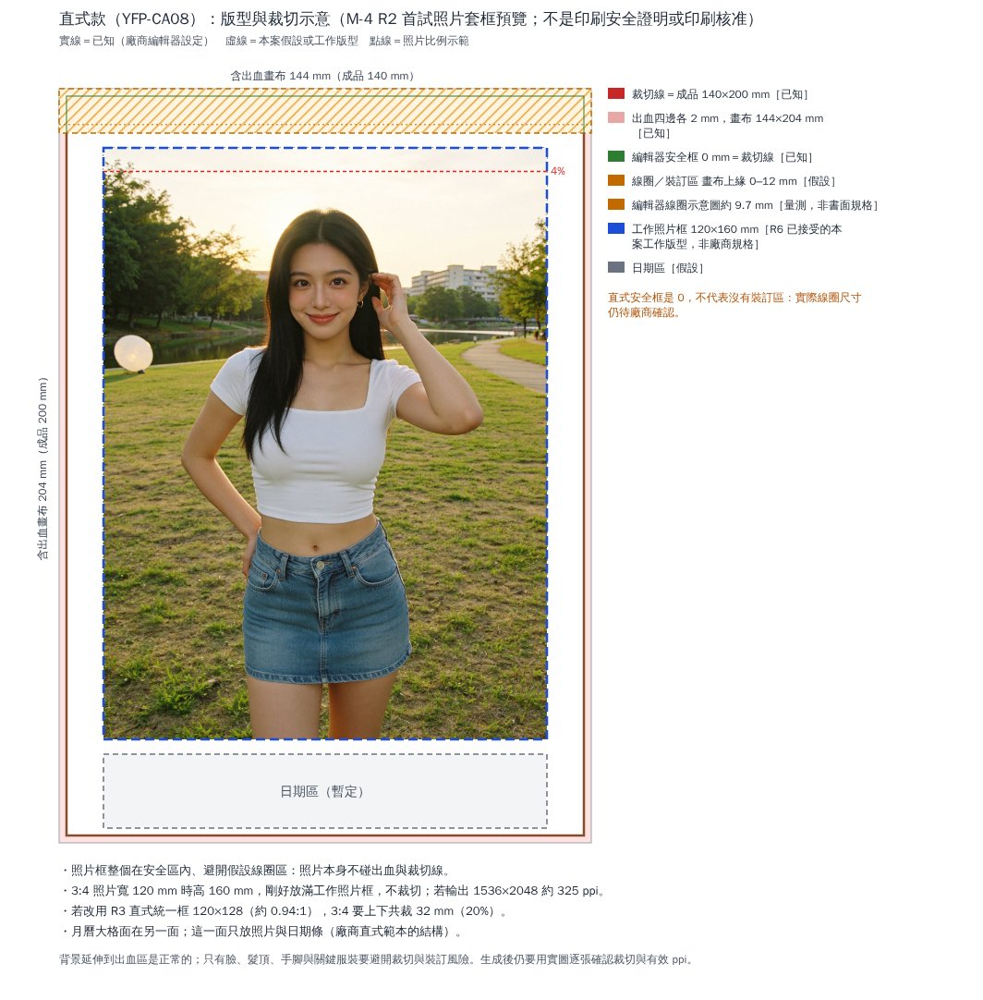

TASK-CAL-001／M-4／R2｜V-Iris單張首試｜送審報告

# M-4／R2 送審紀錄（私有）

- **固定成果 SHA**：`32fec1df14071be27858d038b88304eaff67a31a`（基準：成果 `706618f66707087e9a27dbb94f9ee3b9d256fd6f`、送審 `f511887cae4ea7951da5825d4feca69c109838ad`）
- **部署**：Railway 只更新 `cal2027-decision`，固定到 `32fec1df14071be27858d038b88304eaff67a31a`，deployment `5c21f4f8-5a9b-4316-9bd2-995da459c01b`（SUCCESS）；頁面只更新進度文字，**照片不放公開頁**。其他 service 未動、未合併 main、未開 PR。
- **頁面**：https://cal2027-decision-production.up.railway.app/shoot.html（首試結果文字在「V-Iris 首試結果與核查」段）
- **原圖**：`kols/iris-chen/images/calendar_2027_m4_r2/V-iris-chen_m4r2_first_test.png`（1536×2048 PNG，sha256 `fe1391d945c0b31ed513e9042727c5f0ec8c95e8ab103feb36e34b5d3389ab76`）
- **本輪**：生成請求 1、圖片 1、重送 0、訓練 0、上傳 0；實扣 0.12 credit（依時窗及唯一任務推定）。
- 以下驗收與驗證是執行者自測，不是主管覆核；部署不等於核准，這也不是印刷驗收。

## 1. 授權與 R1 覆核同步

- 新檔 `docs/calendar/data/cal_m4_authorization_r2.json`：逐字保存 Penny 同意的條件（1 張、預算最多 1 credit、精確報價 ≤0.12、只送一次）與主管對 R1 的 6 點覆核；寫明不是無限制授權。
- R1 同步：PASS（主管 M-4 R2 覆核）：接受以既有生產紀錄＋單張首試驗收；交易歸屬只標「依時窗及唯一任務推定」；精確報價與實扣分列；1 credit 是本次核准預算，不是平台保證。
- 建議上限的理由改為：1 credit 是 Penny 同意的本次核准預算（V-Iris 1 張）。工具沒有強制費用上限，不能宣稱平台保證不超扣；精確報價（0.12）與實扣分列，實扣以交易明細為準。

## 2. 原圖與套框預覽

裁切檢視（原生解析度與 2 倍零插值）：`m4_r2/crops_face_hair_hand_native_and_2x_nearest.jpg`、`m4_r2/crops_hip_hand_earring_top.jpg`、`m4_r2/crops_reflector_and_far_right_2x_nearest.jpg`、`m4_r2/crops_corners_native.jpg`。

## 3. 送出前核對與實際設定

| 項目 | 結果 |
|---|---|
| Soul | Iris Chen｜soul_2｜ready；與專案紀錄對應（ID 不公開） |
| 參數 | 與 M-4 R1 相同（quality 1.5k／2k、比例含 3:4、沒有 seed 與 negative prompt；免費額度不可用） |
| 送出前精確報價 | credits 1／credits_exact 0.12（≤0.12，可送出） |
| 重複提交 | 送出前沒有本輪的提交紀錄 |
| 存放 | 帳號偏好 auto_create_project false：不指定資料夾、不建立專案 |
| 交易邊界 | 送出前最新一列 2026-10-20 09:31:49（UTC，非 Soul V2）；前 30 列沒有 Soul V2 |
| 時窗任務基準 | 送出前帳號最近 20 個圖片任務沒有 soul_2 |

**送出（一次）**：generate_image｜soul_2｜Iris 既有 Soul｜quality 2k｜aspect_ratio 3:4｜count 1｜use_unlim false｜不用參考圖與 style_id｜V-iris-chen 已接受 prompt 原文（一字不改）｜只送一次

**任務**：工作 ID `49783f8c-bf8d-4a0f-b315-4eb52bcd1637`（只放這份私有紀錄）｜回應 pending → 輪詢 2 次 → completed｜任務中繼資料：寬高 1536×2048；quality 欄位記為 1080p（後台標籤；請求是 2k）；套用後台預設風格 General（沒有傳 style_id）。

## 4. 逐項驗收（CAL_20）

| 類別 | 條件 | 結果 | 說明 |
|---|---|---|---|
| 身分與身材 | 臉與 Iris 人設一致 | 符合 | 圓臉甜美、雙眼皮大眼、飽滿嘴唇、小下巴；與訓練圖和既有成圖是同一人的觀感（目視）。 |
| 身分與身材 | 膚色白皙自然、沒有被夕陽拍偏 | 符合 | 白皙略暖，沒有過飽和。 |
| 身分與身材 | 黑色柔順直髮過肩；成人樣貌 | 符合 | 中分黑色長直髮過肩。 |
| 身分與身材 | 身材比例符合人設 | 部分符合（待 Penny 判斷） | 腰細、整體比例自然；貼身上衣下的胸型目視比人設的「飽滿 D」保守。只以人設與既有合格參考判斷外觀比例，不從照片量測三圍或罩杯。 |
| 服裝 | 白色貼身羅紋方領短袖短上衣，露腰，不走光 | 符合 | 方領、短袖、細羅紋可見、露腰。 |
| 服裝 | 淺藍高腰牛仔迷你裙，整條入鏡 | 符合 | 高腰、整條入鏡；水洗色偏中淺藍。 |
| 服裝 | 小金色圈耳環；鞋不入鏡 | 符合 | 看得到的一側有小金圈；鞋不在畫面內。 |
| 服裝 | 衣服沒有亂碼文字、品牌或多餘配件 | 符合 | 牛仔褲扣有壓紋，沒有可讀文字。 |
| 姿態與手指 | 正面站立、重心在一腳、臀部微偏；沒有回頭或轉身 | 符合 | 身體正對鏡頭；重心偏移幅度小。 |
| 姿態與手指 | 一手插腰、一手輕碰太陽穴旁的頭髮；手指沒有融合或多指 | 符合 | 碰髮的手：拇指與食指捏住髮束，其他手指自然，沒有融合；插腰的手：手指大多被身體與裙子遮住，看得到的部分沒有異常（原生解析度與 2 倍零插值檢視）。 |
| 姿態與手指 | 沒有多餘肢體；四角與背景掃過 | 符合 | 四角只有天空與草地。 |
| 表情與視線 | 明亮溫暖的笑，只有一個表情 | 符合 |  |
| 表情與視線 | 看鏡頭；眼睛對焦清楚 | 符合 |  |
| 場景 | 台北河濱公園草地、傍晚低太陽、遠處樹林與低矮公寓 | 符合 | 另有河道與步道。 |
| 場景 | 沒有可辨識臉的路人 | 符合（有小落差） | 遠處右側河岸有 1–2 個失焦、無法辨識的人形或物件；近處草地與步道沒有人。與企劃「空無一人」有小落差，記錄。 |
| 場景 | 沒有招牌或亂碼文字；背景不像拼貼 | 符合 |  |
| 場景 | 沒有不該出現的物件 | 不符合 | 畫面左側草地上出現一個白色圓形反光板（含支架）。prompt 寫的是「just out of frame」，這是 SEXY_SCENE_LIBRARY.md §3-F「點名物件就會出現」的已知機制；位置在 120×160 mm 工作照片框內（3:4 不裁切），屬設定落差，依 §10-a 交 Penny 判斷，不自行重生。 |
| 場景 | 光向一致、臉不暗 | 符合 | 夕陽在她身後右上方，形成髮絲與肩線輪廓光；臉部由前方補光照亮、不暗。 |
| 構圖 | 直式 3:4；大腿中段以上，下緣明顯高於膝蓋 | 符合 |  |
| 構圖 | 人物置中、頭頂上方少量留白 | 符合 | 髮頂約在第 212 列（共 2048），頭頂留白約 10.4%（規劃約 8%）。 |
| 構圖 | 雙手在畫面內；自然透視、水平 | 符合 | 建築垂直線不歪，沒有廣角變形。 |
| 質感 | 自然皮膚紋理、看得到毛孔 | 部分符合 | 手臂與腹部有紋理；臉部偏光滑，毛孔不明顯。 |
| 質感 | 專業寫真質感，不是手機自拍感 | 符合 |  |
| 生成後套框與有效 ppi | 實際輸出像素 | 符合 | 1536×2048（與預期相同） |
| 生成後套框與有效 ppi | 套進 120×160 mm 工作照片框 | 符合 | 3:4 放入 3:4，不裁切（套框預覽見送審紀錄） |
| 生成後套框與有效 ppi | 髮頂上方 ≥4%，臉與雙手在框內 | 符合 | 頭頂留白約 10.4%；臉與雙手都在框內 |
| 生成後套框與有效 ppi | 有效 ppi | 符合工作目標 | 寬 1536 px ÷（120 mm ÷ 25.4）≈ 325 ppi；高 2048 px ÷（160 mm ÷ 25.4）≈ 325 ppi。300 ppi 是本案工作目標，不是廠商門檻；沒有放大補像素；不是印刷驗收。 |

**判定：** 部分通過：身分、服裝、姿態與手指、表情、構圖、套框與有效 ppi 都符合；一項不符合——左側草地上出現白色反光板（prompt 寫在畫面外）；兩項待判斷——胸型目視比人設保守、臉部皮膚偏光滑；遠處有失焦人形的小落差。依指示不重送、不再生成，交主管覆核；反光板與身材屬設定落差，由 Penny 判斷。

## 5. 交易與歸屬

| 項目 | 內容 |
|---|---|
| 送出前邊界 | 最新一列 2026-10-20T09:31:49.174243Z Nano Banana 2.1 -2 spend；前 30 列沒有 Soul V2 |
| 扣款 | 2026-10-20T09:44:29.926120Z -0.12 |
| 退款 | 無 |
| 淨額 | -0.12（精確報價 0.12；核准預算 1 credit） |
| 查核時間 | 任務完成後立即（2026-10-20T09:47:45Z）與終態後 15 分鐘（2026-10-20T09:59:50Z） |
| 同時窗其他 Soul V2 列 | 0 筆 |
| 同時窗其他 soul_2 任務 | 0 個 |
| 異常 | 沒有異常（扣款等於精確報價，沒有退款或其他 Soul V2 列） |
| 歸屬層級 | **依時窗及唯一任務推定**；不是直接對帳確認：交易明細沒有工作 ID。 |

依據：

- 送出前邊界之後到終態後 15 分鐘，交易明細只新增一列 Soul V2（−0.12 扣款，時間與任務完成時間同一秒），沒有退款或其他 Soul V2 列。
- 同一時窗帳號的圖片任務裡，soul_2 只有本次這一個；其他模型的任務（3 個 nano_banana_2）與其扣款（3 列 Nano Banana Pro）不是 Soul V2，不影響歸屬。
- 金額與送出前精確報價 0.12 相同。
- 沒有用帳號餘額差額推算。

任務列表只看模型、狀態與時間；沒有開啟、下載或保存他人作品。帳號餘額沒有用來推算。

## 6. 驗證

| 項目 | 結果 | 檔案 |
|---|---|---|
| M-4 R2 定向驗證（授權、R1 同步、24 套不變、首試資料、照片與工作 ID 不公開、頁面進度、歷史保存、複製、溢出、JS 錯誤） | 線上 43/43（本機 43/43） | /home/user/Virtual_KOL_Studio/review/calendar/m4_r2/live_m4r2_tests.tsv |
| 部署前後（測試瀏覽器 localStorage） | 5/5 | /home/user/Virtual_KOL_Studio/review/calendar/m4_r2/live_upgrade_m4r1_to_m4r2.tsv |
| 線上檔案 sha256 與本機比對 | files 666, mismatches 0 [] | /home/user/Virtual_KOL_Studio/review/calendar/m4_r2/live_bytes_check.txt |
| 網站建置器 --check | PASS 654 檔；首試照片不在公開資料夾 | — |
| 企劃文件產生器 --check | PASS（CAL_19 位元組不變） | — |
| kol-catalog 首頁 | 與存檔相同（44801 bytes） | /home/user/Virtual_KOL_Studio/review/calendar/m4_r2/live_bytes_check.txt |

## 7. 停止

依指示在這一次請求後停止：沒有重送、沒有其他生成、沒有訓練或上傳。反光板入鏡與胸型屬設定落差，依 SEXY_SCENE_LIBRARY.md §10-a 交 Penny 判斷；是否修圖、重拍或接受，等主管與 Penny 決定。

## 8. 檔案（完整路徑）

- `/home/user/Virtual_KOL_Studio/kols/iris-chen/images/calendar_2027_m4_r2/V-iris-chen_m4r2_first_test.png`
- `/home/user/Virtual_KOL_Studio/docs/calendar/data/cal_m4_authorization_r2.json`
- `/home/user/Virtual_KOL_Studio/docs/calendar/data/cal_m3_shoot_plan.json`（m4_prep.r2；m4r2.changes）
- `/home/user/Virtual_KOL_Studio/docs/calendar/CAL_20_M4_IRIS_FIRST_TEST_PREP.md`
- `/home/user/Virtual_KOL_Studio/docs/calendar/CAL_18_M3_SHOOT_PLAN.md`
- `/home/user/Virtual_KOL_Studio/kols/iris-chen/generation_notes.md`（新增 2026-10-20 首試紀錄）
- `/home/user/Virtual_KOL_Studio/docs/calendar/decision_site/public/shoot.js`、`shoot.html`、`data.js`
- `/home/user/Virtual_KOL_Studio/review/calendar/m4_r2/copy_example_progress.txt`
- `/home/user/Virtual_KOL_Studio/review/calendar/m4_r2/crops_corners_native.jpg`
- `/home/user/Virtual_KOL_Studio/review/calendar/m4_r2/crops_face_hair_hand_native_and_2x_nearest.jpg`
- `/home/user/Virtual_KOL_Studio/review/calendar/m4_r2/crops_hip_hand_earring_top.jpg`
- `/home/user/Virtual_KOL_Studio/review/calendar/m4_r2/crops_reflector_and_far_right_2x_nearest.jpg`
- `/home/user/Virtual_KOL_Studio/review/calendar/m4_r2/desktop_card_H-luna_verified.jpg`
- `/home/user/Virtual_KOL_Studio/review/calendar/m4_r2/desktop_iris_first_result.jpg`
- `/home/user/Virtual_KOL_Studio/review/calendar/m4_r2/desktop_m3_complete_decisions.jpg`
- `/home/user/Virtual_KOL_Studio/review/calendar/m4_r2/desktop_progress_copy.jpg`
- `/home/user/Virtual_KOL_Studio/review/calendar/m4_r2/desktop_top.jpg`
- `/home/user/Virtual_KOL_Studio/review/calendar/m4_r2/execution_log.json`
- `/home/user/Virtual_KOL_Studio/review/calendar/m4_r2/frame_preview_V_120x160.jpg`
- `/home/user/Virtual_KOL_Studio/review/calendar/m4_r2/live_bytes_check.txt`
- `/home/user/Virtual_KOL_Studio/review/calendar/m4_r2/live_m4r2_tests.tsv`
- `/home/user/Virtual_KOL_Studio/review/calendar/m4_r2/live_upgrade_m4r1_to_m4r2.tsv`
- `/home/user/Virtual_KOL_Studio/review/calendar/m4_r2/local_m4r2_tests.tsv`
- `/home/user/Virtual_KOL_Studio/review/calendar/m4_r2/mobile390_card_H-luna_verified.jpg`
- `/home/user/Virtual_KOL_Studio/review/calendar/m4_r2/mobile390_iris_first_result.jpg`
- `/home/user/Virtual_KOL_Studio/review/calendar/m4_r2/mobile390_m3_complete_decisions.jpg`
- `/home/user/Virtual_KOL_Studio/review/calendar/m4_r2/mobile390_progress_copy.jpg`
- `/home/user/Virtual_KOL_Studio/review/calendar/m4_r2/mobile390_top.jpg`

**本輪數字：** 生成請求 1、圖片 1、重送 0、訓練 0、上傳 0；實扣 0.12 credit（依時窗及唯一任務推定）。
